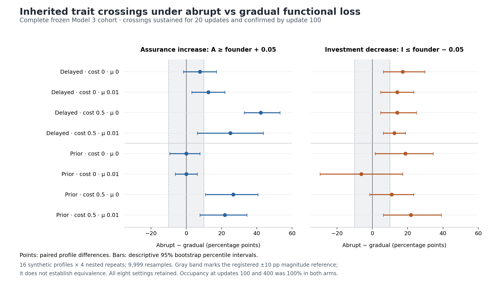

# Chapter 2 — Complete abrupt-versus-gradual functional-loss result

**Date:** 2026-10-11. **Status:** complete source-verified Model 3 result, with independent genome/event/bootstrap verification. The frozen cohort contains **1,024 trajectories × 400 updates**, from **16 synthetic visitor profiles × four nested demographic repeats × eight timing/cost/mutation settings × two visitor schedules**. Natural plant islands sampled: **zero**.

## Scientific finding

Assigned visitor chronology changes inherited trait trajectories in a setting-dependent way. In all four settings with direct assurance cost 0.5, the abrupt schedule has a higher probability of a sustained assurance increase confirmed by100, with differences from **+21.875 to +42.1875 percentage points**. Investment-decrease crossing differences vary from **−6.25 to +21.875 pp** across all eight settings. The full setting grid below includes the zero and negative contrasts.

Every arm remains occupied at100 and400: **64/64 per setting and schedule**. This saturated persistence endpoint supplies no identified survival advantage or harm from visitor tempo, and does not establish a causal inherited-order→survival mechanism. Its degenerate descriptive interval is not evidence of equivalence or proof against a possible benefit under another independently specified ecological regime.

The [complete machine readout](../data/results/chapter2_sequence_abrupt_gradual_functional_loss_20261011.json.gz), [full numeric tables](CHAPTER2_SEQUENCE_ABRUPT_GRADUAL_FULL_TABLES_20261011.md), [independent raw-genome audit](../data/results/chapter2_sequence_abrupt_gradual_independent_audit_20261011.json.gz), and [admission/provenance receipt](../data/results/chapter2_sequence_abrupt_gradual_functional_loss_receipt_20261011.json) preserve every registered endpoint and its support. The numerical tables include all six categories at both horizons and all156 secondary fields per setting.

## Estimand and fixed design

`A` is autonomous reproductive assurance, `I` floral investment, and `X` visitor matching. Actual founder means are **X=.5053281099, I=.5023530254, A=.4850942880**. A registered event requires A at least .05 above its actual founder mean, or I at least .05 below it, for20 consecutive censuses. The onset and confirmation are separate: onset81 confirmed100 counts in the by100 primary; onset82 confirmed101 does not. Near-simultaneous means onset times within five updates.

The intervention changes the optima of four functional visitor types over the first100 updates. It does not remove insect individuals. Abrupt and gradual arms have the same first100 cumulative delivered pollen **only in the fixed clonal N48, X=I=A=.5 calibration population**, and share the same terminal visitor composition from100 through399. Actual evolving pollen is an outcome. Native reproduction, finite diploid inheritance, founders, seeds, K48, ovule budget8, mutation settings and event definitions were unchanged.

Each arm has64 trajectories per setting. The inferential unit is the16 synthetic profile clusters; the four demographic repeats are nested. Differences are paired at that level. Intervals are the frozen **two-sided descriptive percentile bootstrap**, 9,999 draws, seed48272026, tails .025/.975. There is no new confirmatory p-test, equivalence procedure, pooled selected-setting analysis, or natural-island inference. The [original frozen design](../data/design/chapter2_sequence_abrupt_gradual_functional_loss_20261011.json) remains byte-identical, including its historical pre-execution `current_result: NONE`; result admission is recorded separately.

## Primary crossing probabilities confirmed by100

Setting labels are **selfing timing / direct assurance cost / mutation rate**. Probabilities include all64 trajectories in an arm. Differences and intervals are in percentage points (pp), always abrupt minus gradual.

### Assurance increase

| Setting | Abrupt | Gradual | Difference (pp) | Descriptive95 interval (pp) |
| --- | --- | --- | --- | --- |
| delayed / 0 / 0 | 60/64 (93.75%) | 55/64 (85.9375%) | +7.8125 | [−1.5625, +17.1875] |
| delayed / 0 / 0.01 | 61/64 (95.3125%) | 53/64 (82.8125%) | +12.5 | [+3.125, +21.875] |
| delayed / 0.5 / 0 | 53/64 (82.8125%) | 26/64 (40.625%) | +42.1875 | [+32.8125, +53.125] |
| delayed / 0.5 / 0.01 | 46/64 (71.875%) | 30/64 (46.875%) | +25 | [+6.25, +43.75] |
| prior / 0 / 0 | 61/64 (95.3125%) | 61/64 (95.3125%) | 0 | [−9.375, +7.8125] |
| prior / 0 / 0.01 | 61/64 (95.3125%) | 61/64 (95.3125%) | 0 | [−6.25, +6.25] |
| prior / 0.5 / 0 | 55/64 (85.9375%) | 38/64 (59.375%) | +26.5625 | [+10.9375, +40.625] |
| prior / 0.5 / 0.01 | 54/64 (84.375%) | 40/64 (62.5%) | +21.875 | [+7.8125, +34.375] |

### Investment decrease

| Setting | Abrupt | Gradual | Difference (pp) | Descriptive95 interval (pp) |
| --- | --- | --- | --- | --- |
| delayed / 0 / 0 | 12/64 (18.75%) | 1/64 (1.5625%) | +17.1875 | [+6.25, +29.6875] |
| delayed / 0 / 0.01 | 11/64 (17.1875%) | 2/64 (3.125%) | +14.0625 | [+4.6875, +23.4375] |
| delayed / 0.5 / 0 | 9/64 (14.0625%) | 0/64 (0%) | +14.0625 | [+4.6875, +25] |
| delayed / 0.5 / 0.01 | 8/64 (12.5%) | 0/64 (0%) | +12.5 | [+6.25, +18.75] |
| prior / 0 / 0 | 34/64 (53.125%) | 22/64 (34.375%) | +18.75 | [+1.5625, +34.375] |
| prior / 0 / 0.01 | 28/64 (43.75%) | 32/64 (50%) | −6.25 | [−29.6875, +17.1875] |
| prior / 0.5 / 0 | 16/64 (25%) | 9/64 (14.0625%) | +10.9375 | [−1.5625, +23.4375] |
| prior / 0.5 / 0.01 | 24/64 (37.5%) | 10/64 (15.625%) | +21.875 | [+6.25, +39.0625] |

The registered10pp magnitude benchmark is reached by **five A point estimates and seven I point estimates**. Only two A intervals lie wholly above+10pp: delayed/cost.5/mutation0 and prior/cost.5/mutation0. **No I interval lies wholly above+10pp.** These comparisons describe magnitude and uncertainty; they do not upgrade this small synthetic experiment to a confirmatory ecological result. Prior/cost0/mutation.01 gives the negative I point contrast, −6.25pp with interval[−29.6875,+17.1875].

## Realized sequence: A-only is a separate outcome

A-first requires both events within the stated horizon and an A onset more than five updates before I. A-only requires an A event but no confirmed I event within that horizon. For example, delayed/cost.5/mutation0 has53 A crossers under abrupt by100, comprising **8 A-first and45 A-only**. Calling all53 “A-first” would change the result.

The following highlights the two categories most relevant to that distinction. [The complete six-category tables](CHAPTER2_SEQUENCE_ABRUPT_GRADUAL_FULL_TABLES_20261011.md) retain I-first, near-simultaneous, I-only and neither, including observed zero counts. Each cell below is abrupt / gradual, out of64 per arm.

| Setting | A-first by100 | A-only by100 | A-first full400 | A-only full400 |
| --- | --- | --- | --- | --- |
| delayed / 0 / 0 | 10 / 1 | 49 / 54 | 14 / 3 | 46 / 55 |
| delayed / 0 / 0.01 | 9 / 2 | 51 / 51 | 14 / 4 | 48 / 56 |
| delayed / 0.5 / 0 | 8 / 0 | 45 / 26 | 9 / 0 | 47 / 38 |
| delayed / 0.5 / 0.01 | 7 / 0 | 38 / 30 | 16 / 0 | 37 / 47 |
| prior / 0 / 0 | 31 / 17 | 27 / 39 | 31 / 23 | 27 / 33 |
| prior / 0 / 0.01 | 25 / 30 | 34 / 29 | 44 / 45 | 16 / 15 |
| prior / 0.5 / 0 | 7 / 5 | 40 / 32 | 8 / 7 | 39 / 36 |
| prior / 0.5 / 0.01 | 20 / 8 | 31 / 31 | 31 / 20 | 27 / 32 |

A-only is the largest category in every delayed abrupt arm at both horizons and every delayed gradual arm by400. By100, neither is largest in the two costly delayed gradual arms. Both costly delayed gradual arms have **zero jointly crossed trajectories even by400**. The prior/cost0/mutation.01 setting also prevents a universal A-first-advancement claim: its A-first counts are25 versus30 by100, and44 versus45 by400, abrupt versus gradual.

### Conditional onset lag has limited common support

The lag is A onset minus I onset, among trajectories with both events confirmed by400. A negative value means A begins earlier. The paired schedule contrast uses only the same demographic repeats eligible in both arms, averages within each profile, then once per eligible profile. It therefore must not be reconstructed by subtracting the separately eligible arm means. All original16 profiles, including those with no paired support, remain visible in the full JSON.

| Setting | Eligible cases abrupt / gradual | Paired cases / profiles | Paired lag difference (updates) | Descriptive95 interval | Nonempty bootstrap draws |
| --- | --- | --- | --- | --- | --- |
| delayed / 0 / 0 | 15 / 3 | 2 / 2 | +53.5 | [+11, +96] | 8813 |
| delayed / 0 / 0.01 | 16 / 5 | 0 / 0 | NA | NA | 0 |
| delayed / 0.5 / 0 | 9 / 0 | 0 / 0 | NA | NA | 0 |
| delayed / 0.5 / 0.01 | 17 / 0 | 0 / 0 | NA | NA | 0 |
| prior / 0 / 0 | 34 / 28 | 17 / 14 | +7.25 | [−5.0419, +21.6] | 9999 |
| prior / 0 / 0.01 | 48 / 47 | 35 / 16 | −1.2344 | [−64.2458, +60.3549] | 9999 |
| prior / 0.5 / 0 | 16 / 9 | 4 / 4 | +16.5 | [−11, +43] | 9903 |
| prior / 0.5 / 0.01 | 35 / 22 | 12 / 9 | −9.2778 | [−94.0847, +72.3812] | 9999 |

Three settings have no paired lag estimand. The sole lag interval excluding zero is based on **two paired trajectories in two profiles**, with8,813 nonempty resamples out of9,999. The setting with the largest paired support has35 paired cases across16 profiles and a broad interval. These conditional results do not establish a uniform advance or delay of the interval between two genetic events.

## Genotypes and reproductive context

The400-update values below are profile means with64/64 paired trajectories and16/16 paired profiles for all cells. Each cell gives abrupt / gradual. All10/100/400 means, variances, intervals and support appear in the full numeric tables.

| Setting | X at400 | I at400 | A at400 |
| --- | --- | --- | --- |
| delayed / 0 / 0 | 0.622939 / 0.671855 | 0.530183 / 0.637882 | 0.720427 / 0.685792 |
| delayed / 0 / 0.01 | 0.824252 / 0.846043 | 0.589123 / 0.681746 | 0.857148 / 0.786224 |
| delayed / 0.5 / 0 | 0.643112 / 0.67972 | 0.564046 / 0.659307 | 0.625078 / 0.550277 |
| delayed / 0.5 / 0.01 | 0.830816 / 0.875923 | 0.622987 / 0.756084 | 0.628922 / 0.518312 |
| prior / 0 / 0 | 0.581275 / 0.647876 | 0.429631 / 0.466213 | 0.740649 / 0.709959 |
| prior / 0 / 0.01 | 0.652313 / 0.701698 | 0.365175 / 0.37458 | 0.919844 / 0.912867 |
| prior / 0.5 / 0 | 0.611841 / 0.662663 | 0.506583 / 0.556814 | 0.620416 / 0.596183 |
| prior / 0.5 / 0.01 | 0.728188 / 0.83658 | 0.440852 / 0.543974 | 0.728039 / 0.631483 |

Investment is lower under abrupt than gradual at400 in all eight point comparisons. This is a **between-schedule** observation: every delayed arm-average I400 remains above the actual founder I=.502353, and the prior/cost.5/no-mutation abrupt mean is also slightly above it. A transient sustained crossing does not require permanent fixation below the threshold.

Without mutation, most terminal variances of adult diploid trait means approach numerical zero; two gradual/cost0 I cells retain small nonzero variance. Mutation maintains terminal variation. These are measured genotype-mean variances, not a direct demonstration of zero allele diversity or a decomposition of genetic mediation.

| Setting | Mean pollen0–399 | Mean functional overlap0–399 | Selfed-recruit fraction |
| --- | --- | --- | --- |
| delayed / 0 / 0 | 17.745967 / 33.860053 | 0.288557 / 0.438531 | 0.716965 / 0.508276 |
| delayed / 0 / 0.01 | 51.898047 / 71.056444 | 0.611172 / 0.71746 | 0.454045 / 0.296644 |
| delayed / 0.5 / 0 | 20.254718 / 39.452579 | 0.322155 / 0.46484 | 0.655864 / 0.434207 |
| delayed / 0.5 / 0.01 | 58.433105 / 83.647004 | 0.646665 / 0.779178 | 0.379862 / 0.190618 |
| prior / 0 / 0 | 9.685995 / 21.666799 | 0.215389 / 0.391207 | 0.936056 / 0.852296 |
| prior / 0 / 0.01 | 18.839974 / 28.583527 | 0.343293 / 0.483419 | 0.911455 / 0.880484 |
| prior / 0.5 / 0 | 14.270508 / 27.564073 | 0.258306 / 0.414422 | 0.865777 / 0.754698 |
| prior / 0.5 / 0.01 | 30.806821 / 54.150347 | 0.478013 / 0.695982 | 0.804626 / 0.648665 |

Actual mean pollen and overlap are lower under abrupt in every setting; selfed-recruit fractions are higher. This is compatible with fixed-reference dose matching because the actual X/I/A/census states evolve. Native pre-mutation expected I response is smaller under abrupt in every point comparison, but both arms have **positive** time-averaged expected I responses in all delayed settings. Lower delivery or a lower between-arm I mean alone does not imply population decline.

All ten registered gradient times are retained. At t40, the mean of sampled investment-gradient medians is negative under abrupt in every setting. In the delayed mutation-enabled settings, this quantity returns positive in both schedules by t200/t300. These are genotype-dependent sampled paths, not an irreversible fixed-clonal clock or exact first sign-crossing times. Each within-trajectory sample contains at most eight selected adults. One assurance median at t200 is unavailable in the gradual prior/cost0/mutation.01 cell; its eligible paired count is63, with all16 profiles retained. Missing values and positive/negative/near-zero/boundary/evaluated counts remain explicit in the full tables.

## Persistence consequence

For **all eight settings**, both schedules have occupancy100=occupancy400=64/64. Every paired difference is0pp with descriptive interval[0,0]. No observed occupancy400 contrast reaches the registered5pp magnitude benchmark. This is a ceiling-limited outcome: it supplies no identified persistence benefit, harm or practical-equivalence result. The experiment changes visitor chronology; it does not independently assign A/I mutation order or intervene on an inherited-order mediator.

The defensible four-question update is: realized local selection paths vary with the evolving state (Q1); registered crossing/order outcomes depend on visitor tempo and mating/genetic context (Q2); native diploid inheritance produces and preserves measurable trajectory differences (Q3); a persistence consequence remains unidentified in this saturated cohort (Q4). Earlier failed, equivalent, inconclusive and supported studies retain their own evidence ranks. No submission headline or natural island extinction/rescue claim is changed.

## Execution and verification

- Source [PR #475](https://github.com/zuizui0223/izu-core/pull/475) merged as [`dba65f11a4ee7295ae32b623ea1103cc8a25c1b5`](https://github.com/zuizui0223/izu-core/commit/dba65f11a4ee7295ae32b623ea1103cc8a25c1b5), tree `1bf4ce5d291d966631b1497cc19d6f2a5d058c78`.
- Before execution, the local full suite passed1,462 tests and the focused repair suite passed29. Independent source review approved the unchanged executable fingerprint. Exact-main [Python3.10/3.11/3.12 CI](https://github.com/zuizui0223/izu-core/actions/runs/38114199578) and the [scientific gate plus review package](https://github.com/zuizui0223/izu-core/actions/runs/38114199570) all completed successfully.
- The unchanged batch CLI executed16 shards, all1,024 cases, on the local committed-main executor. This was not a GitHub cohort workflow run; no cohort Actions run ID or17-artifact inventory is claimed.
- The official strict reader validated every case/receipt and all16 manifests, original diploid traces, native parentage, overlap, source/design/founder/runtime identity, horizons and derived flags.
- An independent calculator reconstructed events from **410,624 raw diploid censuses**, matching all128 setting/outcome comparisons and the9,999-draw profile bootstrap. Its independent scope covers genetic-event and occupancy statistics; secondary gradient/pollen/overlap/parentage summaries remain covered by the official reader and separate implementation/scientific review.
- Complete machine JSON SHA256: `a1b5e84c61e9cc242af8a71bafe57bf852e233445e3e4e7476333aca252009af`. Its deterministic gzip is359,539 bytes, decompresses to the exact7,207,383 original bytes, and has SHA256 `f6056b3e0d96e0d8f610d7c0ed0eccb3ed789f5fa88e69e40e4e70671a3cd7bc`.
- Independent audit JSON SHA256: `ece61c3ce978c58c359ed618ffa31bf4dfe20e7f7c530f55b613d42625e0b600`; the exact full audit is also preserved as deterministic gzip and in the raw archive.

The [admission receipt](../data/results/chapter2_sequence_abrupt_gradual_functional_loss_receipt_20261011.json) records actual execution times, all source/design/founder/runtime fingerprints, sixteen manifest hashes, archive byte verification and preservation status. The [raw-archive ledger](CHAPTER2_INDEPENDENT_RAW_ARCHIVES_20261009.md) keeps this local16-profile cohort separate from the four older64-history Actions cohorts. A private preserved copy is not a public scientific deposit or DOI.

The complete raw archive is **268,940,123 bytes**, SHA256 **`034e735d244228c1f4974897a76d16acef10767a81d5dd82f5f5204f48cf0738`**. All2,099 members were stream-verified; a subsequent retrieval of the saved artifact into a separate path matched both size and SHA256. Its2,064 original raw JSON files remain unchanged.
