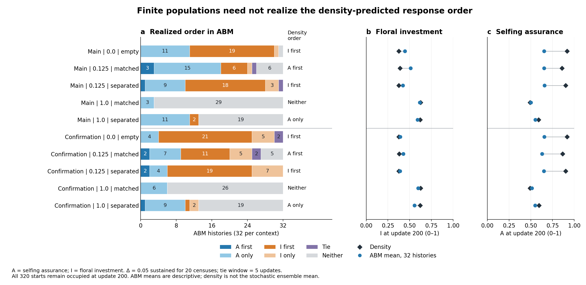

# Completed original-mutation numerical and ABM comparison

All 30 atom-plus-cell archives completed; all 10 contexts pass both registered adjacent-grid comparisons (65→129 and129→257). The full-weight numerical verifier and independent completion envelope agree. Original mean/census/covariance/CDF/event thresholds were not changed. Prior uniform0/10 and centered4/10 verdicts remain frozen.

This representation separates the exact initial assurance atom from continuous mutated mass, integrates the original finite-rate reflected Gaussian birth mutation into cells, and uses midpoint reproductive quadrature. Only assurance mutates; matching and investment retain standing alleles. This is a native discrete-update genotype-density calculation, not a heat-equation replacement, full three-locus PDE, SPDE, or the assumed ABM ensemble mean. Horizon200; capacity48; two founder backgrounds and five static visitor contexts.

Maximum errors across20 adjacent-grid comparisons: max_mean_error=0.000867108935, max_census_error=7.81597009e-14, max_covariance_error=4.00407066e-05, max_checkpoint_allele_cdf_error=0.004186323. Passing declared grid tests is not a proof of an exact universal solution.

All320 original matching ABM histories are retained. A separate implementation recomputed990 event classifications and40 checkpoint summaries from archived arrays. This audit does not newly derive all trait arrays from annual raw genomes. Threshold sensitivities0.025/0.05/0.10 are in the accompanying CSV. No new significance test was introduced.

| Context | Density order | A first | A only | I first | I only | Tie | Neither |
|---|---|---:|---:|---:|---:|---:|---:|
| Main | 0.0 | empty | I first | 0 | 11 | 19 | 1 | 0 | 1 |
| Main | 0.125 | matched | A first | 3 | 15 | 6 | 1 | 1 | 6 |
| Main | 0.125 | separated | I first | 1 | 9 | 18 | 3 | 1 | 0 |
| Main | 1.0 | matched | Neither | 0 | 3 | 0 | 0 | 0 | 29 |
| Main | 1.0 | separated | A only | 0 | 11 | 2 | 0 | 0 | 19 |
| Confirmation | 0.0 | empty | I first | 0 | 4 | 21 | 5 | 2 | 0 |
| Confirmation | 0.125 | matched | A first | 2 | 7 | 11 | 5 | 2 | 5 |
| Confirmation | 0.125 | separated | I first | 2 | 4 | 19 | 7 | 0 | 0 |
| Confirmation | 1.0 | matched | Neither | 0 | 6 | 0 | 0 | 0 | 26 |
| Confirmation | 1.0 | separated | A only | 1 | 9 | 1 | 2 | 0 | 19 |

At low supply0.125 with matched visitor function, density predicts assurance-first for both founders, but ABM realizes that category in3/32 and2/32 histories; assurance-only occurs in15/32 and7/32. All32 histories per context remain occupied at200. The difference therefore is not due to extinct histories being removed. It does not isolate drift, parental sampling, mutation access or density effects. At Δ0.025 the same density trajectories are near-simultaneous: order is event-definition dependent.

The matched numerical comparison does not identify a persistence advantage: this cohort has saturated occupancy. Separate mutation-access preparation experiments estimate conditional preparation-policy effects in demographic challenges, not a pure naturally evolved sequence effect.

Execution: https://github.com/zuizui0223/izu-core/actions/runs/38120835221 at executor source e331e0fe2c0048f94197f41f34575dbcd77c0377. Completed scientific verification is separate from PR477 normal CI, whose manual-trigger policy repair is included in this branch; fixed-head normal CI remains a separate validation.

Latest repository provenance correction: PR483 at main25ada7ee authenticates no original discovery case. Later confirmation/generality archive recovery covers12,544 cases and cannot substitute for missing discovery archives or historical runtime/annual-genome evidence.
